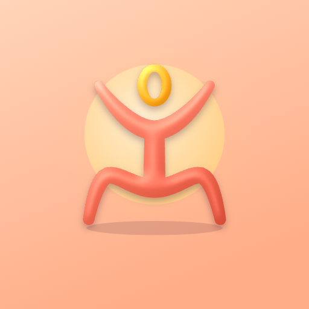

# MyoZen

A free 3D muscle atlas for Android. Tap any muscle to see what it does, how to find it and where it can send pain. Tap the spot that hurts and see which muscles may be behind it. There are animations of everyday movements, a quiz, and private notes about your own body.

No ads, no account, nothing leaves your phone. Russian and English.

**Download:** the latest APK is on the [Releases](../../releases) page.

MyoZen is for learning and self-help. It is not a medical diagnosis.

### If MyoZen helped

I make it on my own, in my spare time. If it helped your neck, your back or your anatomy exam, you can buy me a coffee. It keeps the app free and growing.

---

Бесплатный 3D-атлас мышц для Android. Нажимаешь на мышцу и видишь, что она делает, как её найти и куда она может отдавать боль. Нажимаешь, где болит, и видишь, какие мышцы могут быть причиной. Есть анимации движений, режим «Проверь себя» и личные отметки о своём теле.

Без рекламы и регистрации, данные не покидают телефон. Русский и английский.

**Скачать:** свежий APK на странице [Releases](../../releases).

Приложение для обучения и самопомощи, а не для диагностики.

Если MyoZen помог, можно [угостить меня кофе на Ko-fi](https://ko-fi.com/aliyame).

## What is in this repository

Only the 3D model the app uses, published under its open license, plus this page and the privacy note. The app's own code, texts and design are not open source.

- `model/atlas.glb` — the muscle and bone model.
- `model/structures.json` — one entry per mesh: id, side, English and Latin name, layer, body region.

## Model license

The model is an adaptation of [Z-Anatomy](https://www.z-anatomy.com) (CC BY-SA 4.0), which is based on [BodyParts3D](https://dbarchive.biosciencedbc.jp/en/bodyparts3d/download.html), © The Database Center for Life Science (CC BY-SA 2.1 Japan). The semispinalis capitis is taken from BodyParts3D directly.

Changes: the model was simplified and compressed for phones, the semispinalis capitis was fitted into it, muscle layers were computed automatically, Latin names were added from Terminologia Anatomica 2 (from the Z-Anatomy set).

`model/atlas.glb` and `model/structures.json` are licensed under [CC BY-SA 4.0](https://creativecommons.org/licenses/by-sa/4.0/). You can share and adapt them, also commercially, as long as you credit the authors above and share your adaptations under the same license.

See also [PRIVACY.md](PRIVACY.md).
